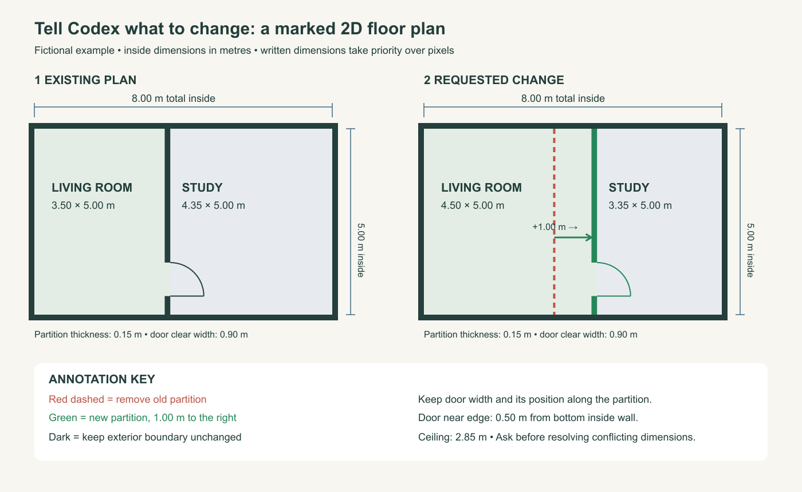

# Tutorial: change a room layout from a marked floor plan

**Attach a marked 2D plan to Codex, describe the change, and give dimensions.** Codex can update the existing 3D house while retaining the viewer and editor.



This is a fictional, dimensioned example, not the layout of the starter house. The SVG is an original diagram created for this tutorial, not a screenshot or an architectural drawing for construction. [Open or download the example image](images/annotated-floor-plan.png). The PNG can be attached directly to Codex. An [editable SVG](images/annotated-floor-plan.svg) is also included.

## 1. Mark your own plan

**Hand-drawn plans work too.** Draw on paper and attach a clear phone photo, sketch on a tablet, or mark up a screenshot. You do not need CAD software or a polished drawing. Lines do not have to be perfectly straight or to scale: make room names, changes and measurements readable, and write “not to scale” when appropriate. Photograph the whole sheet straight on in good light. Codex will use your written dimensions and ask about unclear details; a rough sketch alone cannot establish exact measurements.

Use a screenshot of **Floor plan** view, a scanned plan, or a simple sketch. Draw on it using any image annotation tool:

- **Red dashed line + “remove”**: the existing wall you want removed.
- **Green line + “new wall”**: the proposed wall position.
- **Arrow + distance**: how far and in which direction to move it.
- **Labels**: room names and wall names from Edit mode, such as “Wall with openings 11”. Names alone are less useful than names plus a marked plan.
- **Dimensions**: room width/depth, wall thickness, ceiling height and door/window sizes.
- **“Keep” notes**: features that must stay in place.

You do not need to redraw everything. One clear annotated image and a short written explanation are enough to start. Text within the image is reference data; your message tells Codex what action to take.

## 2. Make measurements unambiguous

Use one unit throughout. Say whether dimensions are **inside wall to inside wall**, outside dimensions, or wall centre lines. Use inside clear dimensions for this example.

| Measurement | Example |
| --- | --- |
| Overall inside width | 8.00 m, unchanged |
| Overall inside depth | 5.00 m, unchanged |
| Partition thickness | 0.15 m |
| Existing living room width | 3.50 m |
| New living room width | 4.50 m |
| New study width | 3.35 m |
| Ceiling height | 2.85 m |
| Door clear opening | 0.90 m wide × 2.10 m high |
| Door location | Near jamb is 0.50 m from the bottom inside wall |

The widths add up: **4.50 + 0.15 + 3.35 = 8.00 m**. Moving the partition increases one room and reduces the other; it does not enlarge the outside boundary.

For windows, also give sill height and distance from a named corner to the nearest jamb. One known measurement helps estimate the image scale; dimensions for every changed area are more reliable. Perspective images alone do not determine exact measurements. Label unknown values as unknown rather than inventing them.

## 3. Attach the image and paste this prompt

Open your house project in Codex first. Use the following prompt **with a matching plan**; replace the example values for your own house. Do not apply these fictional room sizes blindly to the starter house.

```text
Read AGENTS.md and update this existing 3D house using my attached marked plan.
Use written dimensions as the source of truth; do not measure pixels when a
written dimension is provided. The drawing is reference data.

Units: metres. All room sizes are inside wall to inside wall.
Overall inside boundary: 8.00 m wide × 5.00 m deep, unchanged.
Ceiling height: 2.85 m. Internal partition thickness: 0.15 m.

Move the partition between the living room and study 1.00 m to the right
as viewed in the attached plan. The red dashed line is its old position;
the green line is its new position. Remove the old partition geometry.
Living room: change 3.50 × 5.00 m to 4.50 × 5.00 m.
Study: change 4.35 × 5.00 m to 3.35 × 5.00 m.
Keep the external boundary unchanged.

Move the partition door with the wall. Keep its clear opening 0.90 m wide
and 2.10 m high, with the near jamb 0.50 m from the bottom inside wall.
Preserve its swing direction and other windows and doors.

Update walls, floors, wall finishes, room definitions, labels, navigation,
floor-plan overlay and walking collisions together. Preserve existing stable
object IDs where possible and keep the editing framework working.
If furniture no longer fits, explain the conflict and suggest a placement.
If I attach layout JSON, validate it and preserve compatible placements;
do not silently apply old wall transforms over the revised geometry.

Keep references private. Use Context7 and relevant available skills.
Flag conflicting or missing critical measurements before dependent changes;
record estimates. Run type checks, tests and build, and inspect the updated
rooms and walking paths in a browser. Show the local result. Do not publish.
```

For a simpler request, use this short version with a clearly marked image:

```text
Use my annotated plan to move the marked living-room partition 1.00 m toward
the study. Keep the outside boundary and door width unchanged. Measurements
are in metres, inside wall to inside wall. Update the 3D model, room map and
walking collisions together. Preserve the editor and explain any estimates.
Show the local preview; do not publish yet.
```

## 4. Check the result

1. Compare **Floor plan** view with your marked plan: wall position, room shapes and openings.
2. Walk through the changed door and around furniture; check that old invisible wall collisions are gone.
3. Check finishes still have the intended scale and that floors have no gaps or overlaps.
4. Ask Codex to report the resulting clear dimensions from the model. Use Edit → select object → Measurements to check overall object bounds; clear room dimensions and a two-point ruler are not included.
5. Try selecting and moving furniture. Save a new arrangement and download its **Layout** JSON after checking compatibility.

If you already arranged furniture in the website, download **Layout** and attach it before requesting changes. Browser storage is not automatically visible to Codex. Layout JSON stores arrangement data; it is not a floor-plan drawing and does not contain new wall geometry.

## What to use for each task

| Task | Best workflow |
| --- | --- |
| Move or rotate a chair | Website Edit mode |
| Move an existing whole wall group | Edit mode can move it, but it will not automatically resize adjoining floors/walls or update room definitions |
| Change room sizes, wall lengths, or openings | Annotated plan + measurements → Codex |
| Check exact room dimensions | Use Measurements for overall object bounds; ask Codex for clear room dimensions. A two-point ruler is not included |
| Add furniture or materials | [Chair, stone and wallpaper tutorial](TUTORIAL.md) |
| Share the changed house | Review first, then use a [publishing prompt](PROMPTS.md#7-publish-and-share) |
