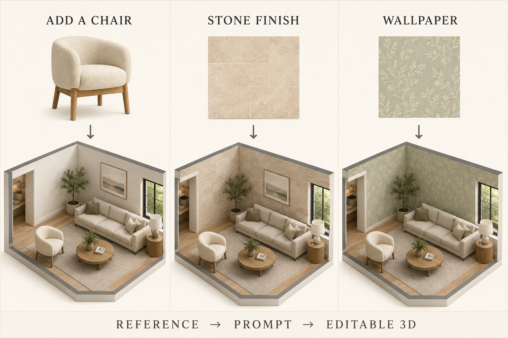

# Tutorial: add furniture, stone and wallpaper

**Changing room sizes or walls?** See the [annotated floor-plan tutorial](ROOM-LAYOUT-TUTORIAL.md).


**Open your house project in Codex, attach a reference, and paste one of the prompts below.** Codex updates the real Three.js model; you then arrange it in the browser.



*AI-generated concept illustration, not an app screenshot or a promised rendering result. The three scenes show possible design directions. The actual model remains an approximation of your references.*

## Before you start

1. Open your own copy of this repository in Codex. Follow the [README setup](../README.md#run-the-example-locally) if you have not run it yet.
2. If you have arranged furniture in the website, download **Layout** and attach that JSON too. Browser saves are not automatically visible to Codex.
3. Attach a chair photo or material sample. Tell Codex the room, target object or wall, and any known measurements. A marked screenshot helps identify the wall.
4. Paste a prompt below. Replace the bracketed parts with your choices.
5. Review the local preview, ask for adjustments, then export a PNG or publish when ready.

The website already supports object placement and rotation. **Adding new furniture geometry or custom texture assets requires Codex.** For included finishes, select an object in Edit mode and use Material. It replaces all opaque surfaces in that group; targeted single-face edits still use Codex. There is no automatic image converter or texture painting tool.

## 1. Add a chair from a photo

**Example:** a cream curved-back chair with oak legs beside the living-room sofa.

Attach your chair photo, then paste:

```text
Read AGENTS.md and use my attached chair photo as visual reference.
Add one approximate 3D chair beside the living-room sofa, facing the coffee
table. Match the curved upholstered back, cream fabric and oak legs.
Use these dimensions if provided: [width, depth, height in metres]. Otherwise
estimate them and tell me the assumptions.

Build actual Three.js geometry. Reuse lib/lounge-chair.ts where appropriate,
and register the chair as one named editable assembly with a stable ID.
Keep the seat, back and legs together when moving or rotating. Make duplicate,
delete, undo/redo, layout save/load and GLB export work with the chair.
Preserve existing furniture and keep a usable walking path around it.

If I attach a layout JSON, validate it against this house and preserve that
arrangement. Keep the original photo in ignored references/.
Use Context7 and relevant skills. Run type checks, tests and the build; check
the chair and editing controls in a browser. Show me the local result.
Do not publish yet.
```

Then try it yourself:

1. Open **Edit** and select the chair.
2. Move it with the handles; rotate it toward the sofa or coffee table.
3. Use **Duplicate** for a second chair; use **Delete** to remove an unwanted copy.
4. Try **Undo**, then **Save arrangement** and download **Layout** for a backup.

Follow-up prompt:

```text
Make the new chair's back more curved and its oak legs slimmer. Preserve its
stable ID and placement, and keep the whole chair selectable as one object.
```

## 2. Add a stone texture to a wall

**Example:** warm beige limestone on the living-room wall behind the sofa.

Attach a flat, evenly lit stone sample if you have one. A perspective photo with shadows is a style reference; it may need a clean replacement texture before it can tile well.

```text
Read AGENTS.md. Apply a warm beige limestone finish to only the living-room
wall behind the sofa [or the wall marked in my screenshot]. Use my attached
stone image as a visual reference. Keep openings, trim and other walls intact.

Aim for a matte surface with subtle stone variation and approximately
60 cm wide by 30 cm high blocks. If the reference cannot tile cleanly, create
an original procedural texture or use the available image-generation tool
to make a flat tileable texture inspired by its general appearance.
Keep my original photo private. Store only the new intended website texture
in public/textures/ and record how it was created.

Use a separate material for the target wall face so shared materials do not
change other surfaces. Set the texture scale from real wall dimensions;
avoid stretching, obvious seams and baked-in lighting. Use appropriate
Three.js texture color space and roughness. Keep walking and editing intact.
Use Context7. Run type checks, tests and build; inspect the wall from close
up and across the room in a browser. Verify PNG and GLB exports include the
finish. Show the local result; do not publish yet.
```

Follow-up prompt:

```text
Make the stone blocks half as large and slightly warmer. Keep the wall size,
openings and all furniture unchanged.
```

**Check:** blocks have believable scale, corners and openings remain clean, and unrelated walls have not changed. A color texture alone does not create deep stone relief; request geometry or suitable surface maps if that depth matters.

## 3. Add wallpaper

**Example:** a subtle sage botanical pattern on one bedroom wall.

Attach a wallpaper swatch and identify the wall. For an original pattern, describe it instead.

```text
Read AGENTS.md. Add wallpaper to the bedroom wall behind the bed
[specify the bedroom or attach a marked screenshot]. Use a muted sage-green
botanical pattern on a warm ivory background, inspired by my attached swatch
if present. Keep the ceiling, trim, openings and adjacent walls unchanged.

Create an original repeating pattern with the available image-generation
tool or procedural drawing. Keep the original swatch in ignored references/;
put the new intended website texture in public/textures/ and record its origin.
Use an approximately 50 cm horizontal pattern repeat, upright leaves and a
matte finish. Map it at consistent physical scale without stretching.
Give this wall face its own material and avoid flickering overlapping faces.

Preserve furniture IDs, arrangements and editor behavior. Use Context7.
Run type checks, tests and build, then inspect the wallpaper in a browser
and verify PNG and GLB exports. Show the local result; do not publish yet.
```

Follow-up prompt:

```text
Make the wallpaper pattern more subtle, with smaller leaves and less contrast.
Keep it on the same wall and preserve my furniture arrangement.
```

**Check:** the pattern stays upright, repeats at the intended size, and does not cover windows or doors. Seamless generation is a goal, not a guarantee: inspect the repeated texture and correct visible joins.

## 4. Review, render and share

For a comparable image, keep the same camera and daylight settings before and after the change. Use **Save render** to download a PNG from the actual model.

```text
Show the updated room from an eye-level camera that includes the new chair
and wall finish. Use soft daylight and export a PNG from the actual model.
Do not substitute an AI-generated concept image for the model render.
```

- **Layout JSON** transfers positions, rotations, duplicates and deletions within a compatible house. It does not carry new chair geometry or texture files.
- **GLB** transfers exported geometry and materials to compatible tools; verify the exported appearance after adding textures.
- **The project source plus assets** carries these additions to another copy of the editor. Ask Codex to reuse the furniture module and material assets in a different house.
- New model or material defaults need a new deployment to reach website visitors. [Use a publishing prompt](PROMPTS.md#7-publish-and-share) when you want that.

## Notes for Codex: material implementation

Use isolated materials for the intended surfaces. Cloning a material still shares its texture references; clone a texture as well when changing repeat settings independently. Base-color textures use sRGB; normal and roughness maps contain non-color data. Configure wrapping and UV scale for each surface's physical dimensions.

References: [Three.js textures guide](https://threejs.org/manual/en/textures.html), [color management](https://threejs.org/manual/en/color-management.html), [Material.clone](https://threejs.org/docs/#api/en/materials/Material.clone).

## Illustration provenance

The illustration above was created with the built-in image-generation tool for this tutorial. No private house plan or user furniture photo was supplied to that generation. It is a documentation asset, not a seamless texture, furniture model or measured plan. [Generation prompt](images/GENERATION.md).
